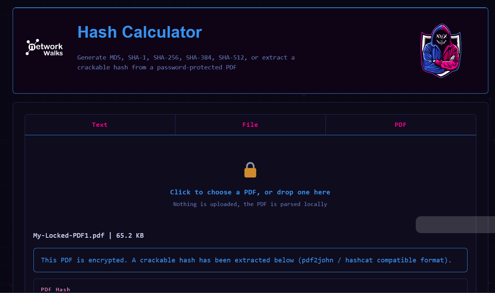
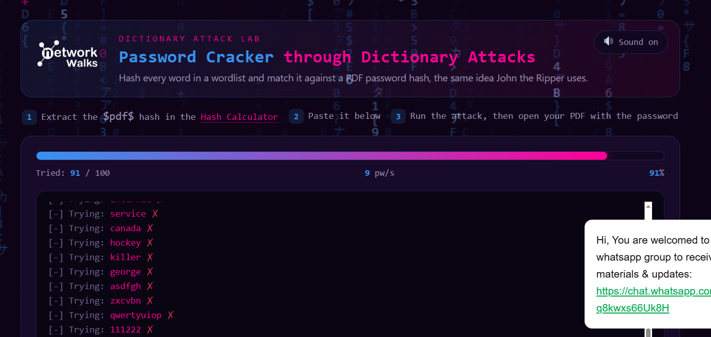

# Module 2: Password Cracking with NetworkWalks Tools

## Overview

This module focused on password security and the process of recovering a password from a protected PDF file using NetworkWalks online tools.

The lab introduced the use of a Hash Calculator to extract a hash value from a password-protected PDF and a Password Cracker to demonstrate how weak passwords can be recovered.

## Objectives

- Understand the concept of password cracking.
- Learn the difference between hashing and encryption.
- Understand how password hashes are extracted from protected files.
- Explore the NetworkWalks Hash Calculator.
- Explore the NetworkWalks Password Cracker.
- Understand the importance of strong passwords.

## Tools Used

- NetworkWalks Hash Calculator
- NetworkWalks Password Cracker
- Windows laptop
- Web browser
- Sample password-protected PDF file

## Lab Environment

The practical exercise was conducted on a Windows laptop using browser-based NetworkWalks tools.

## Practical Documentation

### 1. Hash Calculator

The Hash Calculator was used to extract the hash value from the provided password-protected PDF file.

**Screenshot:**

### 2. Password Cracker

The extracted hash was used in the Password Cracker to demonstrate the password recovery process.

**Screenshot:**

### 3. Lab Completion

The final stage involved verifying the recovered password by opening the protected PDF file.

**Screenshot:**

## Key Concepts Learned

### Hashing

Hashing is a one-way process that converts data into a fixed-format value known as a hash. Hashes can be used to verify data and are commonly used in password storage.

### Encryption

Encryption is a process that transforms readable data into an unreadable form using a key. Unlike hashing, encryption is designed to be reversible when the correct key is available.

### Password Security

Weak and commonly used passwords are more vulnerable to recovery attempts. Strong passwords should be long, unique, and difficult to guess.

## Ethical Considerations

Password security testing should only be performed on files, systems, and accounts that you own or have explicit authorization to test.

## Conclusion

This practical introduced password hash extraction and password security testing using NetworkWalks browser-based tools. It demonstrated the importance of using strong passwords and understanding how weak passwords can compromise protected files.
